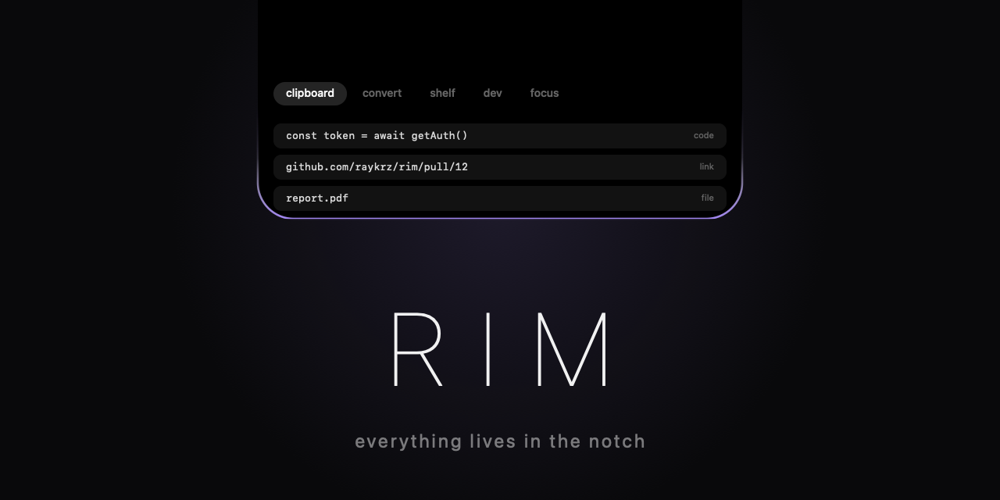

<p align="center">
  
</p>

# RIM

A command deck for developers that lives in your MacBook's notch. Hover the notch and it opens. Move away and it tucks back in.

On Macs without a notch, RIM draws a small pill at the top center of the screen instead.

> Early development (v0.1). Everything below works, but expect rough edges.

## Install

RIM needs macOS 13 or later, on Apple silicon or Intel.

### Download

1. Open the [latest release](https://github.com/raykrz/Rim/releases/latest) and download `RIM.zip`.
2. Unzip it and drag `RIM.app` into your Applications folder.
3. Open it once. macOS will refuse, because RIM isn't notarized yet (that needs a paid Apple Developer account). Allow it in one of two ways:
   - Open System Settings, go to Privacy & Security, scroll down to the message about RIM, and click Open Anyway.
   - Or run this in Terminal:

     ```bash
     xattr -dr com.apple.quarantine /Applications/RIM.app
     ```
4. Move your pointer to the top center of the screen. The notch opens.

You only need to do step 3 once. RIM has no Dock icon, so look for the small notch icon in the menu bar if you need to quit it, or use the ⋯ menu inside the notch.

### Build from source

You only need the Command Line Tools, not Xcode.

```bash
xcode-select --install
git clone https://github.com/raykrz/Rim.git
cd Rim
./scripts/bundle.sh
cp -R build/RIM.app /Applications
open /Applications/RIM.app
```

Apps you build yourself don't get the macOS warning. To just try it without installing, run `swift run` instead.

### Start at login

Open the ⋯ menu inside the notch and turn on Launch at login. This works from the installed app in Applications.

### Update and uninstall

To update, quit RIM from the ⋯ menu and replace the app with the new version. To uninstall, quit it and drag `RIM.app` to the Trash. RIM stores nothing else, apart from a daily focus-session count in your preferences and an optional log if you ever run it with `--debug`.

## Permissions

RIM asks only for what a feature needs, the first time you use it.

| Permission | Why |
|---|---|
| Automation: Finder | "Use Finder selection" in Convert |
| Automation: Spotify or Music | Now playing and play/pause in Focus |

If you said no by mistake, change it in System Settings > Privacy & Security > Automation. RIM never needs Accessibility, Screen Recording or Full Disk Access.

## What it does

| Tab | What you get |
|---|---|
| Clipboard | History of text, code, links and files. Passwords and keys are masked and wiped after a minute. |
| Convert | Drop a file or use the Finder selection and convert it. |
| Shelf | Park files for a moment and drag them out into any app. |
| Dev tools | JSON, Base64, JWT, hashes, timestamps, colors and more on your clipboard text. |
| Focus | A countdown timer shown beside the notch, plus now-playing controls. |

### Clipboard

Click an item to copy it back. Files restore as real files you can paste into Finder, Mail or chat apps. Right-click an item to remove it, or to show a file in Finder.

- History lives in memory only and is never written to disk.
- Items that password managers mark as concealed are ignored.
- Strings that look like API keys, private keys or passwords are masked. Click the eye to reveal one for 5 seconds. After 60 seconds it leaves the history, and the system clipboard is wiped too if nothing else was copied since.
- Copying a secret back out of RIM marks it as concealed so other clipboard managers skip it.
- Password detection is a heuristic (8 to 64 characters, no spaces, mixed character types), so it can occasionally mask an ordinary identifier.

### Convert

Drag a file toward the notch. Two drop zones appear: Convert and Shelf. Or open the Convert tab and click "Use Finder selection". Results are saved next to the original, and everything uses tools built into macOS.

| From | To |
|---|---|
| Images (PNG, JPG, HEIC, TIFF, GIF, BMP) | JPG, PNG, PDF |
| Word, RTF, HTML, text, Markdown, ODT | Word, text, HTML, RTF, PDF |
| PDF | Text, Word (editable text or exact look), PNG (page 1) |
| MOV, MP4, M4V | MP4, M4A audio |

Word to PDF reads `.docx` files directly, so tables, images, lists, links and basic styling carry over. Headers, footers and complex layouts aren't covered.

PDF to Word has two modes. "Editable text" keeps bold, italic and sizes and joins wrapped lines back into paragraphs, but drops images and table structure. "Exact look" puts each page in the Word file as a picture, so it looks identical but isn't editable.

If [LibreOffice](https://www.libreoffice.org) is installed, RIM uses it for Word to PDF and adds a "to Word (LibreOffice)" option for PDFs, which gives the best layout in both directions.

### Shelf

Drop files on the Shelf zone to park them, then drag them out into any app later. Right-click a file for Open, Show in Finder, Convert and Remove. The shelf holds references to the original files, not copies, and is emptied when you quit.

### Dev tools

Open the tab and your clipboard text is already in the input box, unless it looks like a secret. Click a tool to run it, edit the input to re-run it live, and copy the result.

JSON format and minify, Base64, URL encoding, JWT decode (with expiry), SHA-256, SHA-1, MD5, new UUID, timestamps (seconds, milliseconds or a date), colors (hex, rgb, hsl), and snake_case, kebab-case and camelCase.

### Focus

A countdown timer with 15, 25 and 50 minute presets and a label for what you're working on. While it runs and the notch is closed, a progress ring appears on the left of the notch and the time left on the right. When it ends, the notch opens, plays a sound, and tucks itself away after a few seconds.

The right half shows what Spotify or Music is playing, with previous, play/pause and next.

## Troubleshooting

- **Nothing happens when I hover.** Check that RIM is running (notch icon in the menu bar). On a Mac with an external display, RIM uses the built-in screen. Use the menu bar icon's Pin open to hold it open.
- **macOS says the app is damaged or can't be opened.** Run the `xattr` command from the install steps.
- **Finder selection or now playing doesn't work.** Allow RIM under System Settings > Privacy & Security > Automation.
- **Something looks wrong with the clipboard.** Start RIM with `--debug` and read `~/Library/Logs/RIM.log`. It records pasteboard types and counts, never your clipboard contents.

## Design

Near-black, one violet accent, no chrome. The tabs are icons and the selected one shows its name. A thin edge of light runs along the bottom of the open notch, which is where the name comes from. The icon and banner are drawn by `scripts/make-assets.swift`, so they stay in the same style as the app. Run `./scripts/make-icon.sh` to regenerate them.

## Contributing

Each tab is a module: conform to `NotchModule` in `Sources/RIM/` and add it to `ModuleRegistry` in `Modules/Module.swift`. Releases are built by GitHub Actions when a tag like `v0.1.0` is pushed.

Launch options for development: `--pinned` holds the notch open, `--tab=<id>` picks the starting tab, `--shelf=<path>` preloads a file, `--tool=<id>` runs a dev tool on the clipboard, `--focus-start=<seconds>` starts the timer, `--dragging` shows the drop chooser, and `--debug` writes the log. `RIM --convert <file> <ext> [button title]` and `RIM --devtool <id> <input>` run the converter and the dev tools without a window.

## License

MIT
